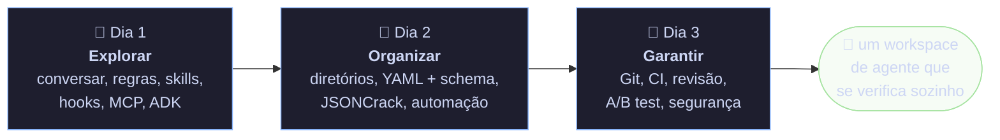

# Workshop Antigravity: do primeiro comando à esteira com qualidade

São **três encontros de 60 a 90 minutos**. No fim, cada dupla tem um workspace de agente funcionando na própria máquina, com:
- regras e skills;
- um hook de custo;
- loops validados por schema;
- um portão de qualidade no commit e no CI;
- um teste A/B de prompt.

É a mesma disciplina de engenharia de loops aplicada em miniatura e operada pelo Antigravity.



## Para quem é
Para o **time misto**: analistas e estagiários, em **duplas**. Cada lab tem duas trilhas:

| Trilha | Para quem | Como é |
|---|---|---|
| 🟢 **Trilha guiada** | quem nunca programou | comandos prontos para copiar e o resultado esperado descrito |
| 🔴 **Desafio** | quem já programa | o mesmo objetivo com menos passo a passo e uma volta a mais |

A dupla troca de papel a cada lab. **Quem escreve não aprova:** a outra pessoa revisa. Essa é a regra "criador ≠ verificador". Termo novo? Clique nele (por exemplo, [agente](glossario.md#agente)) ou abra o [glossário](glossario.md).

## Como cada encontro funciona
- **Núcleo (60 min):** abertura, demonstração, lab e checkpoint. Acontece mesmo se atrasar.
- **Extensão (30 min):** o segundo lab ou o tour avançado. Só se o núcleo terminou.
- **Para casa:** o desafio longo e tudo o que depende de conta, custo ou rede.

No topo de cada encontro há uma **linha do tempo** clicável. O botão **🎙️ Facilitador** mostra as notas de condução e um cronômetro por bloco.

## O fio condutor: engenharia de loops
Uma arquitetura de loops bem feita tem um contrato para agentes, loops com verificação, estado e parada, política como código e um validador. O kit recria cada peça com o recurso equivalente do Antigravity:

| Conceito genérico | No kit (`lab-agy`) | No Antigravity |
|---|---|---|
| contrato canônico (regras sempre ativas) | `AGENTS.md` | [rule](glossario.md#rule) sempre carregada [SRC-03] |
| procedimento sob demanda (como pensar) | `.agents/skills/<nome>/SKILL.md` | [skill](glossario.md#skill), que vira `/nome` [SRC-03] [SRC-08] |
| política como código | `CONTRATO/politica.yaml` + hook | [permissão](glossario.md#permissão) + [hook](glossario.md#hook) [SRC-07] [SRC-03] |
| spec com verificar, estado e parada | `LOOPS/*/loop.yaml` + schema | [LoopAgent](glossario.md#loopagent) no ADK [SRC-05] |
| validador que roda antes de aceitar o trabalho | `FERRAMENTAS/validar.py` | hook `Stop` que "verifica antes de parar" [SRC-03] |
| mapa visual da estrutura | `FERRAMENTAS/mapa.py` | a saída JSON do `agy -p` vira mapa [SRC-08] |

## Preparação da máquina (na véspera, 20 min)
- [ ] Python 3.12: `python --version`
- [ ] Git: `git --version`. Configure nome e e-mail com `git config --global user.name "Seu Nome"` e `git config --global user.email "voce@empresa"`
- [ ] Antigravity CLI instalado e com login feito: `agy --version` mostra 1.2.x [SRC-01]. Rode `agy` uma vez e siga o login da tela [SRC-02]
- [ ] VS Code com a extensão **YAML** (Red Hat), que dá autocomplete e erro na hora pelo schema (Lab 2)
- [ ] (🔴 opcional) conta no GitHub e `gh auth login` (Lab 4 🔴)
- [ ] (💲 opcional, para casa) `pip install google-adk==2.3.0` (agente ADK)

### Copiar o kit para uma pasta sua
O kit fica em [`../kit/`](../kit/testar.py). Copie **duas** pastas para a sua Área de Trabalho: `inicial` vira `lab-agy`, e `caca-ao-risco` vai para o Lab 6.

🪟 **PowerShell (Windows)**
```
Copy-Item -Recurse "CAMINHO-DO-KIT\inicial" "$HOME\Desktop\lab-agy"
Copy-Item -Recurse "CAMINHO-DO-KIT\caca-ao-risco" "$HOME\Desktop\caca-ao-risco"
cd "$HOME\Desktop\lab-agy"
```
🐧 **bash (Linux, macOS, Git Bash)**
```
cp -r CAMINHO-DO-KIT/inicial ~/Desktop/lab-agy
cp -r CAMINHO-DO-KIT/caca-ao-risco ~/Desktop/caca-ao-risco
cd ~/Desktop/lab-agy
```
Depois, nos dois sistemas:
```
pip install -r requirements.txt
git init
git add .
git commit -m "ponto de partida do workshop"
python FERRAMENTAS/validar.py
```
O validador mostra **1 loop com problema**. Isso é de propósito: é o Lab 2.

> [!WARNING]
> Nunca rode os labs dentro de `MAIN_AG`, desta arquitetura ou de uma pasta com dado real. O `lab-agy` é de treino e pode quebrar à vontade.

## Regras da casa para o workshop
1. **Sandbox e aprovação primeiro.** Projeto novo começa pedindo permissão para tudo; só relaxa depois de testado. O padrão do CLI é `toolPermission: request-review` [SRC-06].
2. **Custo zero por padrão.** Nada de BigQuery, GCP ou API paga nos labs. O que usa modelo está marcado com 💲. O próprio `agy` consome a cota da sua conta: confira com `/usage` e `/credits` [SRC-06].
3. **Nada de dado real.** Use os exemplos de `pedidos/`.
4. **Perguntou, esperou.** Comando de nuvem ou que apaga arquivo só roda depois de um "pode".

> [!CAUTION]
> Abra `~/.gemini/antigravity-cli/settings.json` e procure `dangerouslySkipPermissions`. Se estiver `true`, vale o mesmo que a flag `--dangerously-skip-permissions`: o agente aprova sozinho todo pedido de permissão [SRC-01]. Para o workshop, deixe `false`. No Linux e no macOS, rode com `agy --sandbox` [SRC-01] [SRC-07]. No Windows, a doc não deixa claro se o sandbox do CLI funciona [SRC-07]; use o modo com aprovação e as regras `deny`.

## Mapa do material
| Encontro | Pergunta | Labs |
|---|---|---|
| [Dia 1: Explorar o Antigravity](dia-1.md) | O que o Antigravity sabe fazer e como a gente manda nele com segurança? | [Lab 1: regra, skill e guarda de custo](dia-1.md#d1-lab1) |
| [Dia 2: Engenharia de software para agentes](dia-2.md) | Como arrumar o repositório para o agente errar menos? | [Lab 2: YAML que se valida](dia-2.md#d2-lab2) · [Lab 3: JSONCrack e contrato de saída](dia-2.md#d2-lab3) |
| [Dia 3: DataOps e qualidade](dia-3.md) | Como uma mudança chega em produção sem quebrar, vazar ou custar caro? | [Lab 4: commit, PR e CI](dia-3.md#d3-lab4) · [Lab 5: A/B test](dia-3.md#d3-lab5) · [Lab 6: caça ao risco](dia-3.md#d3-lab6) |

## Para o facilitador
> 🎙️ **Facilitador:** faça as demos no **seu** `lab-agy`, nunca num projeto real. Monte as duplas antes, sempre com um analista e um estagiário. Se o login do `agy` falhar para alguém, essa pessoa faz o lab junto com outra dupla: o objetivo é ver o fluxo, não ter duas telas.

> 🎙️ **Facilitador:** antes de cada turma, rode `python kit/testar.py` na pasta da missão. Ele aplica o gabarito de cada lab numa cópia temporária e confere o resultado, sem rede, sem modelo e sem nuvem. Se passar, os labs funcionam.
