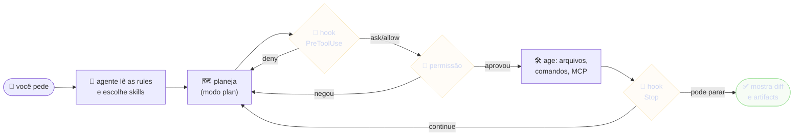
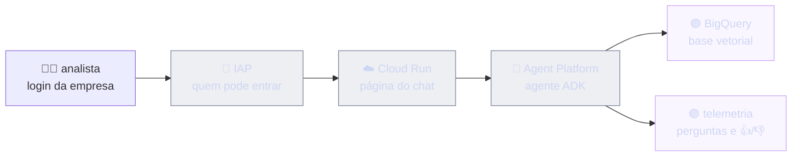

# Dia 1: Explorar o Antigravity

<a id="d1-abertura"></a>
## ⏱️ 8 min · Abertura: o que é o Antigravity

**Em 30 segundos:** o Antigravity é a plataforma de desenvolvimento com agentes do Google. Você pede, e o [agente](glossario.md#agente) planeja, lê e escreve arquivos, roda comandos e mostra o que fez [SRC-02]. Ele existe em quatro formas:

| Superfície | O que é | Quando usar | Hoje |
|---|---|---|---|
| **[CLI](glossario.md#cli)** (`agy`) | o agente no terminal, leve e rápido | tarefas do dia a dia, scripts, automação | 🧪 labs [SRC-02] |
| **App Antigravity 2.0** | aplicativo de desktop que lança e acompanha vários agentes, com projetos e tarefas agendadas | orquestrar várias conversas e automações | 🎬 demo [SRC-02] |
| **IDE Antigravity** | editor (base VS Code) com autocomplete, edição inline (`Ctrl+I`) e agente na lateral | programar com o agente ao lado | 🎬 demo [SRC-02] |
| **SDK Python** (`google-antigravity`) | o mesmo agente dentro de um script | testes automáticos e pipelines | 🧭 tour [SRC-02] |

**Analogia:** o agente é um estagiário muito rápido que trabalha no seu computador.
- Ele lê as regras da casa ([rules](glossario.md#rule)).
- Ele consulta manuais de procedimento ([skills](glossario.md#skill)).
- Ele pede autorização antes do que é arriscado ([permissões](glossario.md#permissão)).
- Um porteiro confere certas ações antes e depois ([hooks](glossario.md#hook)).


<small>Cada volta do agente, com os pontos onde nós controlamos o que ele faz. Os eventos de hook são os da doc do Antigravity [SRC-03].</small>

> [!IMPORTANT]
> Esses conceitos não são exclusivos do Antigravity: todo bom processo de agente tem, com outros nomes, um contrato de regras, política como código, verificadores obrigatórios e uma condição de parada. Hoje vocês veem como o Antigravity implementa cada peça; amanhã e depois, como organizar e garantir a qualidade.

> 🎙️ **Facilitador:** pergunte "quem já recebeu de um chatbot uma resposta confiante e errada?". A diferença aqui é que o agente **age** no computador, e é por isso que regras, permissões e hooks importam. Mostre a tabela e siga para a demo.

<a id="d1-demo"></a>
## ⏱️ 15 min · Demo ao vivo: conversar, planejar e permitir

O facilitador faz no `lab-agy` dele, e quem quiser acompanha no seu.

**1. Ver a versão e as opções.** `agy --version` mostra a versão e `agy --help` lista as flags e os subcomandos (`agents`, `mcp`, `models`, `plugin`…) [SRC-01].

**2. Abrir e pedir ajuda.** Rode `agy` na pasta do [workspace](glossario.md#workspace) e digite `/help`. A lista completa de [slash commands](glossario.md#slash-command) tem mais de 40 itens [SRC-06]. Os que mais usamos:

| Comando | Para quê |
|---|---|
| `/help` | lista tudo |
| `/skills` | skills disponíveis; cada skill do workspace vira `/nome` [SRC-08] |
| `/plan <tarefa>` | gera um plano (artifact *Implementation Plan*) antes de executar |
| `/context` | quanto do [contexto](glossario.md#contexto) já está ocupado |
| `/permissions` · `/hooks` · `/mcp` · `/agents` | ver e ajustar permissões, hooks, servidores MCP e agentes |
| `/model` · `/effort` | trocar o [modelo](glossario.md#llm) e o esforço de raciocínio |
| `/diff` · `/artifact` | revisar mudanças e [artifacts](glossario.md#artifact) (`Ctrl+R`) |
| `/rewind` · `/fork` | voltar a conversa ou abrir um caminho paralelo |
| `/usage` · `/credits` | cota e créditos da sua conta |
| `/learn` | transformar as correções da sessão em rule ou skill |

Os comandos vêm da referência oficial do CLI [SRC-06]. No texto do pedido, `@arquivo` anexa um arquivo e `!comando` roda algo no terminal [SRC-08].

**3. Modos.** São três: `default`, `accept-edits` (aprova edições sozinho) e `plan`. `Shift+Tab` alterna entre eles, e `--mode` escolhe na abertura [SRC-08]. Faça ao vivo:
```
agy --mode plan
```
Depois peça: *"Explique este workspace e proponha como consertar o loop triagem-de-pedidos. Não mude nada."* Mostre o plano e aprove ou rejeite no painel de artifacts: `y` aprova, `n` rejeita, `c` comenta uma linha [SRC-08].

**4. Permissões.** Peça algo que roda comando (*"rode o validador"*) e mostre o pedido de aprovação. Explique os níveis de `toolPermission` [SRC-06]:
- `request-review` é o padrão: pede para escrever, rodar comando e acessar a web;
- `proceed-in-sandbox` segue sozinho dentro do [sandbox](glossario.md#sandbox);
- `strict` pede para tudo que não é leitura;
- `always-proceed` não pede nada.

Regras finas ficam em `permissions` (`allow`, `ask`, `deny`) com alvos como `command(python FERRAMENTAS/validar.py)`, `read_file(.env)`, `read_url(dominio)` e `mcp(servidor/ferramenta)`. Quando duas regras conflitam, **deny vence ask, e ask vence allow** [SRC-07].

**5. Modo sem conversa ([print mode](glossario.md#print-mode)).** Um pedido, uma resposta, pronto para scripts [SRC-01] [SRC-08]:
```
agy -p "Liste os loops deste workspace" --output-format json
```
A saída é JSON com a resposta e o consumo [SRC-08]. Amanhã a gente abre esse JSON no JSONCrack.

> [!CAUTION]
> `--dangerously-skip-permissions` aprova tudo sem perguntar [SRC-01]. Regra da casa: projeto novo começa com aprovação e só relaxa depois de testado e homologado.

> 🎙️ **Facilitador:** não passe dos 15 minutos. Se o login ou a rede falhar, mostre os comandos sem executar e siga para o Lab 1: o lab funciona mesmo que só uma pessoa da dupla tenha o `agy` pronto.

<a id="d1-lab1"></a>
## ⏱️ 30 min · Lab 1: regras, skill e guarda de custo

**Objetivo:** ensinar o workspace a trabalhar do jeito da casa. Vocês vão escrever uma [rule](glossario.md#rule) (sempre vale), uma [skill](glossario.md#skill) (procedimento sob demanda) e, no desafio, um [hook](glossario.md#hook) (porteiro que bloqueia custo).

Onde cada customização mora e quando ela entra no contexto do agente [SRC-03] [SRC-08]:
```json jsoncrack
{
  "workspace (a pasta do projeto)": {
    "AGENTS.md ou GEMINI.md": {"é": "rule", "entra": "sempre, para a pasta e as subpastas", "limite": "24 KB por arquivo"},
    ".agents/": {
      "rules/*.md": {"é": "rule com gatilho", "gatilhos": ["always_on", "model_decision", "glob", "manual"]},
      "skills/<nome>/SKILL.md": {"é": "skill", "entra": "só nome e descrição; o resto quando ativa", "vira": "/nome"},
      "agents/<nome>.md": {"é": "agente customizado", "chama com": "/agents ou --agent"},
      "hooks.json": {"é": "hooks", "eventos": ["PreToolUse", "PostToolUse", "PreInvocation", "PostInvocation", "Stop"]},
      "mcp_config.json": {"é": "servidores MCP (ferramentas externas)"},
      "plugins/<nome>/plugin.json": {"é": "pacote com tudo acima"}
    }
  },
  "global (~/.gemini/config/)": {"vale para": "todos os projetos da máquina", "prioridade": "abaixo do workspace"},
  "CLI (~/.gemini/antigravity-cli/settings.json)": {
    "toolPermission": ["request-review", "proceed-in-sandbox", "strict", "always-proceed"],
    "permissions": {"allow": ["command(...)"], "ask": ["..."], "deny": ["read_file(.env)"]}
  }
}
```

### 🟢 Trilha guiada
- [ ] Na pasta `lab-agy`, abra o agente: `agy` (no Linux ou no macOS, prefira `agy --sandbox`)
- [ ] Peça: *"Leia o AGENTS.md e me diga, em 3 linhas, as regras que você vai seguir aqui."* Ele responde sem você colar o arquivo: rules entram sozinhas [SRC-03]
- [ ] No editor, abra `AGENTS.md` e escreva, no fim, uma seção `## Da dupla` com três regras suas. Exemplo: "toda resposta que muda arquivo termina com *o que mudou · como verifiquei · o que falta*" (modelo em [`gabarito/lab1/AGENTS.md`](../kit/gabarito/lab1/AGENTS.md))
- [ ] Crie o arquivo `.agents/skills/reformular-pedido/SKILL.md`, com `name` e `description` no topo e os passos e a verificação no corpo. Copie o [modelo do gabarito](../kit/gabarito/lab1/.agents/skills/reformular-pedido/SKILL.md) e a pasta `resources/` junto
- [ ] Saia (`/exit`) e abra o `agy` de novo. Rode `/skills`: a `reformular-pedido` precisa aparecer
- [ ] Rode `/reformular-pedido @pedidos/exemplo-01.md` (ou peça *"use a skill reformular-pedido no pedidos/exemplo-01.md"*)
- [ ] A outra pessoa da dupla confere a seção **Verificação** da skill: cinco rótulos e nenhum número inventado

✅ **Pronto quando:** a skill devolve os cinco campos para `pedidos/exemplo-01.md` sem inventar prazo nem número, e a outra pessoa da dupla conferiu.

### 🔴 Desafio
- [ ] Crie `.agents/hooks.json` ligando `hooks/guarda_custo.py` ao evento `PreToolUse` com `"matcher": "run_command"` [SRC-03]. O comando roda a partir da pasta do `hooks.json` [SRC-03]
- [ ] Teste o hook sem o agente. No bash: `echo '{"toolCall":{"name":"run_command","args":{"CommandLine":"bq query select 1"}}}' | python .agents/hooks/guarda_custo.py`. No PowerShell: `'{"toolCall":{"name":"run_command","args":{"CommandLine":"bq query select 1"}}}' | python .agents/hooks/guarda_custo.py`. A resposta deve ter `"decision": "deny"`
- [ ] Reabra o `agy` e rode `/hooks`: o `guarda-de-custo` aparece [SRC-06]. Peça *"rode bq query select 1"* e veja o bloqueio com o motivo
- [ ] Abra `.agents/hooks/decisoes.jsonl`: cada decisão virou uma linha (trilha de auditoria)
- [ ] Leia o `guarda_custo.py` e explique à dupla por que ele **nunca** responde `allow`

✅ **Pronto quando:** o agente é bloqueado ao tentar `bq query` sem `--dry_run`, e a decisão aparece em `decisoes.jsonl`. Gabarito: [`gabarito/lab1/.agents/hooks.json`](../kit/gabarito/lab1/.agents/hooks.json).

> [!TIP]
> **Rule ou skill?** A rule vale sempre e ocupa contexto sempre. O limite é 24 KB por arquivo, e as rules sempre ativas dividem um orçamento de 20.000 tokens [SRC-03]. A skill só entra inteira quando a descrição combina com o pedido: antes disso, o agente vê só o nome e a descrição [SRC-03]. Regra curta fica na rule; procedimento vai para a skill.

> [!NOTE]
> **Por baixo do hook:** o Antigravity manda um JSON no stdin do script e lê a decisão no stdout [SRC-03]. `deny` bloqueia, `ask` devolve a decisão para o fluxo normal de permissão e `force_ask` sempre pergunta [SRC-03]. O nosso hook só **restringe**: quando não tem opinião, responde `ask`, e quem libera é a permissão.

> [!WARNING]
> Tutorial antigo fala em *workflows* (`.agents/workflows/`). Eles estão obsoletos e serão retirados em 01/11/2026. Use skills; `/migrate-workflows` converte os antigos [SRC-04] [SRC-08].

> 🎙️ **Facilitador:** o erro mais comum é criar a skill fora de `.agents/skills/` ou esquecer o bloco `---` do frontmatter. Peça para a dupla rodar `/skills` antes de chamar você.

<a id="d1-check"></a>
## ⏱️ 7 min · Checkpoint

<details><summary>1. Qual a diferença entre uma rule e uma skill?</summary>

A rule entra em toda conversa (e ocupa contexto sempre). A skill entra quando a descrição combina com o pedido ou quando alguém digita `/nome` [SRC-03].
</details>
<details><summary>2. O que acontece quando um hook PreToolUse responde "deny"?</summary>

A ferramenta não roda, e o motivo volta para o agente [SRC-03]. No nosso caso, ele aprende que precisa do `--dry_run` antes.
</details>
<details><summary>3. Por que o nosso hook nunca responde "allow"?</summary>

Hook de segurança só restringe. Se ele liberasse, passaria por cima das permissões que a pessoa configurou.
</details>
<details><summary>4. Qual comando mostra quanto do contexto está ocupado?</summary>

`/context` [SRC-06].
</details>

**Rodada final (1 frase por pessoa):** o que você vai usar amanhã no trabalho?

<a id="d1-tour"></a>
## ⏱️ 30 min · Tour: MCP, plugins, subagentes, automações, SDK, ADK e Agent Platform

Cerca de 4 minutos por item. O facilitador mostra, e a dupla anota onde usaria.

### 1. MCP: ligar ferramentas externas
[MCP](glossario.md#mcp) é o padrão para dar ao agente ferramentas de outros sistemas: banco, Jira, navegador. Cada servidor entra em `mcp_config.json`, no workspace (`.agents/`) ou no global (`~/.gemini/config/`), com `command`/`args`/`env` (local) ou `serverUrl` (remoto) [SRC-08]. `/mcp` gerencia, e o subcomando `agy mcp` adiciona, remove, lista, liga e desliga [SRC-01].

> [!IMPORTANT]
> Boa prática: MCP de BigQuery ou Jira só roda com autorização explícita e, no BigQuery, primeiro só metadados e estimativa de custo. Um servidor MCP de terceiro é código de terceiro: entra na auditoria do Dia 3.

### 2. Plugins: o kit do time num pacote
Um [plugin](glossario.md#plugin) junta skills, rules, hooks, MCP e agentes numa pasta com `plugin.json` [SRC-03] [SRC-08]. `agy plugin list|install|enable|disable|uninstall` gerencia os plugins [SRC-01]. Desde o CLI 1.2.11, plugin sem configuração carrega **desligado** [SRC-09]: instalar não é o mesmo que ligar. O Dia 2 empacota o kit como plugin.

### 3. Subagentes e agentes customizados
Um agente customizado é um arquivo `.agents/agents/<nome>.md`. O frontmatter traz `name`, `description`, `tools`, `model` (`inherit`, `flash` ou `pro`) e a política de comandos; o corpo é o system prompt [SRC-08]. Os [subagentes](glossario.md#subagente) nativos são `research`, `browser` e `self` [SRC-08]. `agy agents` lista, e `--agent` escolhe na abertura [SRC-01]. Exemplo de uso: um agente **revisor** que só lê, porque quem escreve não aprova (Dia 3).

### 4. Automações agendadas
`/schedule` roda um prompt num horário ou em [cron](glossario.md#cron) [SRC-06]. A skill embutida `/automation` monta uma automação com cron, e cada execução abre uma conversa nova, do zero [SRC-04]. A automação herda as permissões globais, e o que não estiver aprovado é negado [SRC-04]. O painel de automações é do app Antigravity 2.0 [SRC-08]. Exemplo: "todo dia útil às 9h, rode o validador e me diga o que quebrou".

> [!WARNING]
> ⚠️ Não confirmado: a doc diverge sobre `/schedule` funcionar no CLI ou só no app 2.0 [SRC-08]. Teste na sua versão antes de prometer para alguém.

### 5. SDK Python: o agente dentro de um script
Com `pip install google-antigravity`, o [SDK](glossario.md#sdk) cria o agente em código. Por padrão ele só lê; escrever exige `CapabilitiesConfig()` [SRC-02]:
```python
import asyncio
from google.antigravity import Agent, LocalAgentConfig

async def main():
    config = LocalAgentConfig(system_instructions="Explique o workspace sem mudar nada.")  # só leitura
    async with Agent(config) as agent:
        resposta = await agent.chat("Quais loops existem aqui e qual está quebrado?")
        async for pedaco in resposta:
            print(pedaco, end="")

asyncio.run(main())
```
Serve para testar agentes automaticamente, como no A/B test do Dia 3, e para pipelines. 💲 Consome a cota da conta.

### 6. ADK: construir o seu próprio agente
O [ADK](glossario.md#adk) (Agent Development Kit) é o framework do Google para escrever agentes em Python [SRC-10]. As peças são `LlmAgent`, `SequentialAgent`, `ParallelAgent` e [`LoopAgent`](glossario.md#loopagent). No ADK 2.x, a doc recomenda grafos (`Workflow`) para fluxos novos [SRC-10], e a versão instalada já traz os dois [SRC-05]. A CLI `adk` tem `create`, `run`, `web`, `eval`, `test`, `optimize` e `deploy` [SRC-05].

O kit traz o **mesmo loop do workshop em ADK** ([`adk/revisor/agent.py`](../kit/inicial/adk/revisor/agent.py)): um escritor, um crítico que chama `exit_loop` quando o rascunho passa, e um limite de voltas [SRC-05]:
```python
root_agent = LoopAgent(
    name="revisor_de_pedidos",
    sub_agents=[escritor, critico],   # etapas
    max_iterations=3,                 # PARADA: limite
)                                     # o critico chama exit_loop quando passa (PARADA: sucesso)
```
O escritor lê a crítica anterior com `{critica?}`: o `?` deixa o campo opcional na primeira volta [SRC-05].

> [!NOTE]
> Versão importa: a doc online já está no ADK 2.10.0, e o instalado aqui é o 2.3.0 [SRC-11]. Um exemplo: no 2.3.0, a variável que liga o Google Cloud é `GOOGLE_GENAI_USE_ENTERPRISE` [SRC-05]. Os labs seguem a versão instalada.

### 7. Agent Platform: o agente em produção
Duas coisas levam o nome de plataforma. O **app Antigravity 2.0** orquestra agentes no seu computador [SRC-02]. O **[Google Cloud Agent Platform](glossario.md#agent-platform)** roda agentes em produção: o runtime gerenciado hoje se chama *Agent Platform Agent Runtime* (antes, Agent Engine) e é um serviço pago [SRC-10]. O deploy continua sendo `adk deploy agent_engine --project … --region … --display_name … <pasta>`; a alternativa é `adk deploy cloud_run` [SRC-10] [SRC-05].

Um exemplo comum de arquitetura em produção:

<small>Um padrão comum: a pessoa entra pelo [IAP](glossario.md#iap) com a conta da empresa, e quem fala com o agente é a conta de serviço do [Cloud Run](glossario.md#cloud-run).</small>

> 🎙️ **Facilitador:** feche o tour com a pergunta "qual destas peças resolveria uma dor que você tem hoje?". Anote as respostas: elas viram os pedidos que atravessam a esteira no Dia 3.
