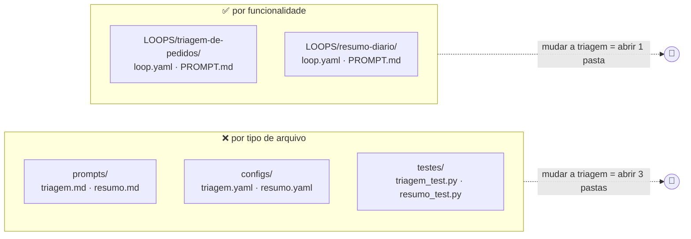
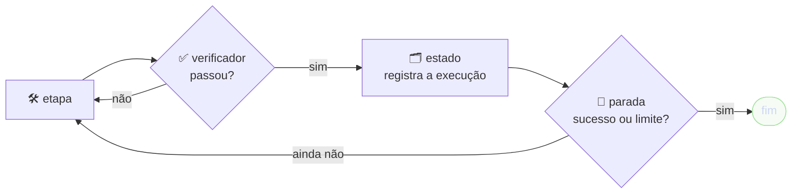
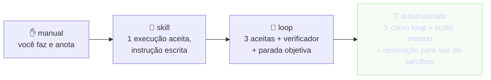

# Dia 2: Engenharia de software para agentes

<a id="d2-abertura"></a>
## ⏱️ 5 min · Abertura: contexto é orçamento

**Em 30 segundos:** o agente só sabe o que cabe no [contexto](glossario.md#contexto) dele, e o contexto tem limite (conta em [tokens](glossario.md#token)). Repositório bagunçado gasta esse orçamento com coisa errada; repositório arrumado entrega só o necessário.

**Analogia:** a mesa de trabalho é pequena. Quem despeja todas as pastas em cima dela não acha nada. Quem guarda cada assunto numa gaveta com etiqueta abre só a gaveta certa.

O Antigravity já trabalha assim. As rules sempre ativas dividem um orçamento de 20.000 tokens; o que passa disso vira só um ponteiro para o arquivo [SRC-03]. Das skills entram só o nome e a descrição até alguém precisar delas [SRC-03]. `/context` mostra o quanto já está ocupado [SRC-06].

> [!IMPORTANT]
> Boa prática: uma ferramenta de automação deve imprimir **só** o necessário para a fase atual do trabalho. A regra é "nunca carregue o projeto inteiro".

<a id="d2-conceitos"></a>
## ⏱️ 15 min · Arquitetura de diretórios e formato por consumidor

### 1. Uma pasta por funcionalidade
Organize **por funcionalidade** (tudo de um loop numa pasta), e não por tipo de arquivo. Para mexer num loop, o agente abre uma pasta só: menos contexto e menos chance de misturar dois processos.



### 2. O Antigravity procura customização subindo as pastas
A partir da pasta onde você está, o agente sobe até a raiz do repositório procurando `.agents/`, `AGENTS.md` e `GEMINI.md` [SRC-03]. Quando dois itens têm o mesmo nome, vence o mais específico: workspace, depois configs declarados (`skills.json`, `plugins.json`), depois o global (`~/.gemini/config/`) e por fim os embutidos [SRC-03]. **A regra mais específica vence.**

### 3. O formato depende de quem lê o arquivo
| Quem lê | Formato | Exemplo no kit | Por quê |
|---|---|---|---|
| a máquina, e o arquivo se repete | [YAML](glossario.md#yaml) + [JSON Schema](glossario.md#json-schema) | `LOOPS/*/loop.yaml` | valida, dá autocomplete e o diff fica limpo |
| o modelo ou uma pessoa | [Markdown](glossario.md#markdown) | `AGENTS.md`, `SKILL.md` | nuance e exemplo se leem melhor em prosa |
| acúmulo ao longo do tempo | [JSONL](glossario.md#jsonl) | `evals/*.jsonl`, `decisoes.jsonl` | só acrescenta linha, nunca edita (histórico imutável) |
| verificação que tem de dar sempre o mesmo resultado | Python | `FERRAMENTAS/validar.py` | reprova sozinho, sem opinião |
| derivado de outros arquivos | o formato de quem consome | `mapa.html` | cabeçalho "GERADO: NÃO EDITAR"; refaça com o comando |

O `SKILL.md` junta dois leitores num arquivo só: o [frontmatter](glossario.md#frontmatter) em YAML serve para a máquina decidir **quando** ativar, e o Markdown serve para o modelo saber **como** fazer [SRC-03].

### 4. A anatomia do `lab-agy`
```json jsoncrack
{
  "lab-agy": {
    "AGENTS.md": {"quem lê": "o agente, sempre", "formato": "md", "muda": "raramente"},
    ".agents": {
      "skills": {"quem lê": "o agente, sob demanda", "formato": "md + frontmatter yaml"},
      "hooks.json": {"quem lê": "o Antigravity", "formato": "json"},
      "hooks": {"quem lê": "a máquina", "formato": "py", "regra": "só restringe"}
    },
    "CONTRATO": {
      "politica.yaml": {"quem lê": "validador e agente", "formato": "yaml"},
      "schemas": {"quem lê": "validador e VS Code", "formato": "json schema"}
    },
    "LOOPS": {"<id>/loop.yaml": {"quem lê": "validador e agente", "formato": "yaml validado", "pilares": ["verificadores", "estado", "parada"]}},
    "evals": {"quem lê": "ab.py", "formato": "jsonl + yaml da regra"},
    "FERRAMENTAS": {"quem lê": "a máquina", "formato": "py", "exemplos": ["validar", "mapa", "ab", "auditar", "ci_local"]},
    "mapa.html": {"é": "GERADO", "refaça com": "python FERRAMENTAS/mapa.py"}
  }
}
```

### 5. Quatro erros comuns
Estes são erros comuns ao organizar um repositório para agentes:
- **pasta vazia como promessa:** "um dia vai ter algo aqui" só confunde o agente;
- **a mesma regra em prosa e em YAML:** um dia as duas divergem, e ninguém sabe qual vale;
- **cópia de documento de outro lugar:** duas versões concorrentes da mesma regra; referencie pelo caminho;
- **conceito virando pasta:** tipo, gatilho e forma são **campos** do YAML, não diretórios.

> [!NOTE]
> Pegadinha clássica do YAML: rode `python -c "import yaml; print(yaml.safe_load('on: push'))"`. O resultado é `{True: 'push'}`, porque na versão 1.1 do YAML `on` vira verdadeiro. É por isso que o schema confere o tipo de cada campo.

<a id="d2-lab2"></a>
## ⏱️ 25 min · Lab 2: YAML que se valida sozinho

**Objetivo:** consertar o [loop](glossario.md#loop) `triagem-de-pedidos`, que está incompleto de propósito. No caminho, vocês usam o validador como [verificador](glossario.md#verificador): o agente só diz "terminei" depois de mostrar o validador passando.


<small>Os três pilares de todo loop: verificar, estado e parada. Sem os três, o schema reprova.</small>

### 🟢 Trilha guiada
- [ ] Rode `python FERRAMENTAS/validar.py`: aparecem **5 problemas** no `triagem-de-pedidos`
- [ ] Abra `LOOPS/triagem-de-pedidos/loop.yaml` no VS Code. A primeira linha (`# yaml-language-server: $schema=...`) liga o schema: passe o mouse nos campos e veja as descrições e os erros sublinhados
- [ ] Abra ao lado o exemplo completo `LOOPS/resumo-diario/loop.yaml`
- [ ] Corrija **um problema por vez** e rode o validador depois de cada correção
- [ ] Ou peça ao agente: *"Corrija o loop triagem-de-pedidos, um problema por vez, rodando `python FERRAMENTAS/validar.py` depois de cada correção. Mostre o diff antes de aplicar."*
- [ ] A outra pessoa da dupla lê o diff final e aprova

✅ **Pronto quando:** `python FERRAMENTAS/validar.py` mostra `2 válido(s) · 0 com problema`. Gabarito: [`gabarito/lab2/.../loop.yaml`](../kit/gabarito/lab2/LOOPS/triagem-de-pedidos/loop.yaml).

### 🔴 Desafio
- [ ] Crie a skill `/validar-loops`, que corrige um problema por vez e termina com a saída do validador (modelo: [`gabarito/lab2/.agents/skills/validar-loops/SKILL.md`](../kit/gabarito/lab2/.agents/skills/validar-loops/SKILL.md))
- [ ] Adicione ao `.agents/hooks.json` um hook `Stop` que roda `hooks/verificar_antes_de_parar.py`. Se o validador falha, o hook responde `continue` e o agente volta ao trabalho [SRC-03]
- [ ] Copie o script do [gabarito](../kit/gabarito/lab2/.agents/hooks/verificar_antes_de_parar.py) e leia o limite de 3 tentativas: por que ele existe?
- [ ] Quebre o loop de novo (apague `parada:`) e peça ao agente *"terminei, pode encerrar"*. Veja o hook mandá-lo de volta

✅ **Pronto quando:** com um loop quebrado, o hook `Stop` manda o agente de volta; depois da correção, o agente encerra sozinho.

> [!TIP]
> A doc do Antigravity pede que toda skill tenha um passo de validação, com a instrução de como provar que deu certo [SRC-03]. O hook `Stop` transforma isso em regra: "terminei" deixa de ser a opinião do agente.

> [!NOTE]
> O limite de tentativas é o pilar PARADA. Sem ele, um validador que nunca passa prenderia o agente num ciclo infinito, gastando cota. O mesmo vale no ADK: `max_iterations` no `LoopAgent` [SRC-05].

<a id="d2-lab3"></a>
## ⏱️ 12 min · Lab 3: JSONCrack e o contrato de saída

**Objetivo:** usar o [JSONCrack](glossario.md#jsoncrack) para **enxergar a estrutura** de um [JSON](glossario.md#json): primeiro o do seu workspace, depois um que vocês nunca viram (a resposta do agente).

### 🟢 Trilha guiada
- [ ] Rode `python FERRAMENTAS/mapa.py` e abra o `mapa.html` no navegador. Clique nos nós: loops, skills, hooks e política
- [ ] 💲 (cota) Rode `agy -p "Liste os loops deste workspace e diga se cada um é válido" --output-format json > saida.json` [SRC-08]
- [ ] Rode `python FERRAMENTAS/mapa.py --arquivo saida.json` e abra o `mapa.html` de novo
- [ ] Achem no mapa: onde está o texto da resposta? Onde está o consumo? Qual campo diz se deu certo?

✅ **Pronto quando:** a dupla aponta no mapa o campo da resposta, o de consumo e o de status da saída do `agy -p`.

### 🔴 Desafio
- [ ] Copie [`status.schema.json`](../kit/gabarito/lab3/CONTRATO/SCHEMAS/status.schema.json) para `CONTRATO/SCHEMAS/` e [`conferir_saida.py`](../kit/gabarito/lab3/FERRAMENTAS/conferir_saida.py) para `FERRAMENTAS/`
- [ ] 💲 Rode `agy -p "Liste os loops e se cada um é válido" --output-format json --json-schema CONTRATO/SCHEMAS/status.schema.json > saida.json`. A resposta estruturada vem no campo `structured_output` [SRC-08]
- [ ] Rode `python FERRAMENTAS/conferir_saida.py saida.json CONTRATO/SCHEMAS/status.schema.json`
- [ ] Discutam: por que conferir de novo, se o `agy` já recebeu o schema?

✅ **Pronto quando:** `conferir_saida.py` diz "saída segue o CONTRATO".

Os campos da saída JSON estão na doc [SRC-08]. Os valores abaixo são fictícios; o de vocês aparece no `saida.json`:
```json jsoncrack
{
  "conversation_id": "…",
  "status": "…",
  "response": "o texto que o agente respondeu",
  "error": null,
  "num_turns": 1,
  "usage": {"…": "descubra no seu saida.json"},
  "structured_output": {"LOOPS": [{"id": "resumo-diario", "valido": true, "problemas": []}], "resumo": "2 válidos · 0 com problema"}
}
```

> [!WARNING]
> Confiar sem conferir é o erro clássico. O schema é o **contrato**; o `conferir_saida.py` é o **fiscal**. Se a resposta vai alimentar outro sistema (planilha, painel, outro agente), confira sempre.

<a id="d2-check"></a>
## ⏱️ 3 min · Checkpoint

<details><summary>1. Por que organizar por funcionalidade ajuda o agente?</summary>

Porque tudo de um processo fica numa pasta só: o agente carrega menos contexto e não mistura processos.
</details>
<details><summary>2. O que decide se um arquivo é YAML ou Markdown?</summary>

Quem vai ler o arquivo. Máquina que valida e processo que se repete ficam em YAML; instrução e narrativa para modelo ou pessoa, em Markdown.
</details>
<details><summary>3. Quais são os três pilares de um loop?</summary>

Verificar, estado e parada. Sem eles, o `validar.py` reprova.
</details>

<a id="d2-automacao"></a>
## ⏱️ 30 min · Automações e o plugin do time

### 1. A escada de maturidade
Nenhum processo nasce automático:


Para subir de degrau, o processo passa pelo **filtro de entrada**: repete? reprova sozinho? o agente executa? o pronto é objetivo?

### 2. Determinístico primeiro
Se um script resolve, o modelo não entra. O `validar.py` diz sim ou não sem gastar nada. O agente entra para o que precisa de julgamento: explicar o erro, propor a correção.

### 3. O agente dentro de um script
No print mode, o código de saída do `agy` diz se deu certo, e dá para encadear com outros comandos [SRC-08]:
```
python FERRAMENTAS/validar.py > validacao.txt || agy -p "O validador falhou. Leia validacao.txt e explique em 3 linhas como corrigir."
```
O agente só é chamado (💲) quando o script determinístico reprova. O `||` funciona no bash e no PowerShell 7; no Windows PowerShell 5.1, rode os dois comandos em linhas separadas.

### 4. Automação agendada
Demonstração, sem ligar a automação. Rode `/automation` e peça: *"todo dia útil às 9h, rode `python FERRAMENTAS/validar.py` neste workspace e me diga o que quebrou"*. A skill monta uma automação com cron e fuso horário (`CRON_TZ=America/Sao_Paulo 0 9 * * 1-5`). Ela libera só o comando que precisa, com `command(python FERRAMENTAS/validar.py)`. Como cada execução começa do zero, o prompt precisa ser completo [SRC-04].

> [!CAUTION]
> Automação roda **sem ninguém olhando**. Antes de ligar: permissões mínimas, nenhum comando de nuvem e o resultado indo para um lugar que alguém lê. Pela escada, isso só acontece depois de o processo ter virado loop.

### 5. O plugin do time
O que a dupla construiu (rules, skills, hooks) pode virar um [plugin](glossario.md#plugin): uma pasta `plugins/kit-dados/` com `plugin.json` e as subpastas `skills/`, `rules/` e `hooks.json` [SRC-03]. Para o time todo receber:
- versione o plugin no repositório;
- aponte para ele em `.agents/plugins.json`, que aceita `entries` e `inherits` [SRC-03];
- quem clonar o repositório recebe o plugin junto.

`agy plugin install <caminho>` instala direto [SRC-08].

> [!IMPORTANT]
> É o princípio "referenciar, não copiar", aplicado entre projetos: o kit vive num lugar só e cada projeto aponta para ele.

> 🎙️ **Facilitador:** feche mostrando o `mapa.html` do seu `lab-agy` depois do Lab 2. Não sobrou nenhum "⚠️ sem parada", e esse é o antes e depois do dia.
