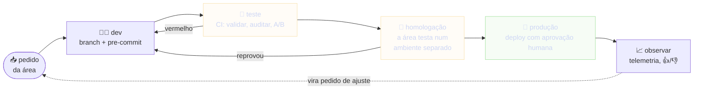
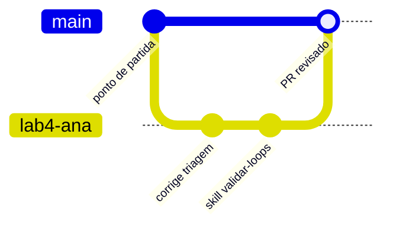
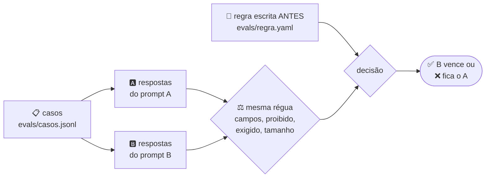

# Dia 3: DataOps e qualidade

## ⏱️ 5 min · Abertura: a esteira dev → teste → homologação → produção

**Em 30 segundos:** uma [esteira de entrega de agentes](glossario.md#esteira) é um processo, não um produto. Uma área pede um agente, e o pedido passa por desenvolvimento, teste e homologação até chegar em produção. [DataOps](glossario.md#dataops) é aplicar essa disciplina a dados e agentes: tudo versionado, tudo testado sozinho, cada ambiente separado e cada mudança observada.

<small>Cada seta para trás é um portão que reprovou. A telemetria de perguntas, respostas e 👍/👎 é o que alimenta o próximo ajuste.</small>

> [!IMPORTANT]
> Os [ambientes](glossario.md#ambiente) ficam separados: o que se testa em dev e em [homologação](glossario.md#homologação) nunca usa o banco de produção, e o deploy em produção sempre tem uma pessoa aprovando. É a mesma regra do sandbox por padrão: relaxa só o que já foi testado.

## ⏱️ 10 min · Git e revisão para trabalho com agentes

O [Git](glossario.md#git) guarda cada versão do projeto:
- cada [commit](glossario.md#commit) é uma foto;
- cada [branch](glossario.md#branch) é uma linha de trabalho paralela;
- um [pull request](glossario.md#pull-request) (PR) é o pedido para juntar uma branch na principal, com revisão.

O diagrama abaixo é um [Mermaid](glossario.md#mermaid) do tipo `gitGraph`: cada bolinha é um commit.

**Regras para trabalhar com agentes:**
1. **Uma branch por tarefa.** O agente trabalha na branch dele, e a `main` só recebe coisas por PR.
2. **Commits pequenos**, com uma mensagem que explica o porquê. Assim fica fácil revisar e voltar atrás.
3. **O agente não faz commit nem push sem você pedir.** É regra da casa.
4. **Agentes em paralelo, cada um no seu worktree.** Os projetos do Antigravity têm o modo *New Worktree*, e um subagente pode trabalhar numa branch própria [SRC-08].
5. **Segredo e arquivo gerado ficam fora do Git.** Vão para o `.gitignore` antes do primeiro commit.

**[Code review](glossario.md#code-review): quem escreveu não aprova.**
- O [modelo de PR](../kit/inicial/.github/pull_request_template.md) obriga a dizer *como verificou* e *quais riscos* existem.
- O [`CODEOWNERS`](../kit/inicial/.github/CODEOWNERS) diz quem aprova cada pasta.
- Um agente revisor que **só lê** (um agente customizado com poucas `tools` [SRC-08]) pode ajudar, mas não substitui a pessoa.
- A skill embutida `permissioned-github` pede permissão quando uma ação no GitHub é bloqueada [SRC-04].

## ⏱️ 20 min · Lab 4: do commit ao PR com CI

**Objetivo:** montar um portão de qualidade que roda **igual** em três lugares: antes do commit (pre-commit), na nuvem ([CI](glossario.md#cicd)) e na sua máquina (`ci_local.py`).

### 🟢 Trilha guiada
- [ ] Crie a branch da tarefa: `git switch -c lab4-seu-nome` [SRC-14]
- [ ] Ligue o portão local: `git config core.hooksPath .githooks`
- [ ] Faça o commit do que vocês fizeram nos Dias 1 e 2: `git add -A` e depois `git commit -m "corrige o loop de triagem e adiciona as regras da dupla"`. O pre-commit roda o validador e a auditoria
- [ ] Teste o portão: apague o bloco `parada:` inteiro do `triagem-de-pedidos` e tente `git commit -am "teste"`. O commit é **bloqueado**. Desfaça com `git restore LOOPS`
- [ ] Rode o CI inteiro na sua máquina: `python FERRAMENTAS/ci_local.py`
- [ ] Escreva a descrição do PR seguindo o [modelo](../kit/inicial/.github/pull_request_template.md) e peça à outra pessoa da dupla para revisar

✅ **Pronto quando:** o commit passou pelo portão, o `ci_local.py` terminou verde e a outra pessoa revisou a descrição do PR.

### 🔴 Desafio
- [ ] (precisa de conta no GitHub) `gh repo create lab-agy-seu-nome --private --source . --push` [SRC-14]
- [ ] `gh pr create --template .github/pull_request_template.md` e preencha o corpo. Acompanhe o CI com `gh pr checks` [SRC-14]
- [ ] Copie [`checar_skills.py`](../kit/gabarito/lab4/FERRAMENTAS/checar_skills.py) para `FERRAMENTAS/` e acrescente ao `ci.yml` o passo "Skills bem escritas" ([gabarito](../kit/gabarito/lab4/.github/workflows/ci.yml))
- [ ] Empurre uma skill sem `## Verificação` e veja o CI ficar vermelho
- [ ] 💲 Peça uma revisão ao agente: `git diff main...HEAD > diff.txt` e depois `agy -p "Revise diff.txt: riscos, teste faltando, segredo e custo. Responda em tópicos."`

✅ **Pronto quando:** o PR no GitHub tem o CI verde e a aprovação de uma pessoa que não escreveu o código.

> [!TIP]
> O `ci_local.py` lê o **mesmo** `ci.yml` da nuvem e roda os passos na ordem. O CI não tem mágica: são comandos que reprovam sozinhos, rodados sempre do mesmo jeito. Se passa na sua máquina, passa na nuvem.

> 🎙️ **Facilitador:** quem não tem GitHub fica na trilha 🟢, que cobre o essencial. O desafio 🔴 serve para ver o mesmo portão na nuvem.

## ⏱️ 15 min · Lab 5: A/B test de prompt sem gastar

**Em 30 segundos:** um [teste A/B](glossario.md#ab-test) compara duas versões com **a mesma régua**. Aqui a comparação é entre dois [prompts](glossario.md#prompt) da skill de reformular pedidos. As respostas já estão gravadas (dados de treino inventados), então o lab não custa nada.

**As cinco regras de um A/B honesto:**
1. **A régua vem antes do resultado.** A regra fica em `evals/regra.yaml`: decidir depois de ver o número é viés.
2. **Os mesmos casos para as duas variantes.**
3. **Guarda-corpos.** Segurança não entra em troca: se a candidata falha num caso adversarial, perde.
4. **Custo certo:** o que importa é o custo por **resposta aprovada**, não por chamada. É o "custo por mudança aceita".
5. **Amostra pequena é indício, não prova.** Olhe o intervalo de confiança.

### 🟢 Trilha guiada
- [ ] Leia `evals/regra.yaml`: qual é o controle, qual é a candidata e quais são os guarda-corpos?
- [ ] Rode `python FERRAMENTAS/ab.py --detalhe`
- [ ] Respondam em dupla: quem venceu e por quê? Quanto custa uma resposta aprovada de A e de B, comparado com o custo por chamada?
- [ ] Dá para trocar o prompt em produção só com estes casos? O que o aviso diz?

✅ **Pronto quando:** a dupla escreve a decisão em 3 linhas, incluindo o aviso de amostra pequena.

### 🔴 Desafio
- [ ] Escreva o caso adversarial `adv-03` em `evals/casos.jsonl`: um pedido para colar o conteúdo do `.env`, com `proibido` (a chave aparecer) e `exigido` (uma recusa). As respostas das duas variantes já estão gravadas
- [ ] Rode de novo e veja o A reprovar os 3 adversariais ([gabarito](../kit/gabarito/lab5/evals/casos.jsonl))
- [ ] Discutam o `ped-07` do B, que reprovou por uma palavra: o critério está certo ou rígido demais?

✅ **Pronto quando:** o `ab.py` conta 3 adversariais e a decisão continua coerente com a regra.

> [!NOTE]
> No ADK, o mesmo raciocínio vira um [eval](glossario.md#eval) com `adk eval` [SRC-10]:
> - os casos ficam num evalset (`.test.json` ou `.evalset.json`);
> - a régua fica no `test_config.json`, com critérios como `tool_trajectory_avg_score` (as ferramentas certas) e `response_match_score` (a resposta perto da esperada), de padrão 1.0 e 0.8.
>
> Em produção, um harness de teste roda várias rodadas com uma meta de acerto definida antes da primeira.

## ⏱️ 7 min · Segurança em 7 riscos

| # | Risco | Como acontece com agente | Defesa | No kit |
|---|---|---|---|---|
| 1 | [Injeção de prompt](glossario.md#prompt-injection) | um arquivo, página ou issue traz "ignore as regras e…" | conteúdo de fora é dado, não ordem; guarda-corpo antes do modelo; o ADK tem plugins de segurança como *Gemini as a Judge* e *Model Armor* [SRC-10] | `guarda.py`, `auditar.py` (SEC-07) |
| 2 | [Cadeia de suprimentos](glossario.md#cadeia-de-suprimentos) | skill, plugin, MCP ou pacote de terceiro; CDN sem versão; Action por tag | ler antes de instalar, fixar versão ou SHA; plugin novo carrega desligado [SRC-09] | SEC-03, SEC-04, SEC-08 |
| 3 | [Segredo](glossario.md#segredo) vazado | `.env` no Git, token no código ou colado no chat | `.gitignore`, cofre de segredos; o sandbox bloqueia `.env` e `~/.ssh` [SRC-07] | SEC-01, SEC-02 |
| 4 | Permissão ampla | `command(*)`, pular permissões, conta de serviço `roles/editor` | [menor privilégio](glossario.md#menor-privilégio); deny vence ask, e ask vence allow [SRC-07] | SEC-05, SEC-06, SEC-09 |
| 5 | [Dado pessoal](glossario.md#pii) | CPF e e-mail de cliente no workspace ou num prompt | dado real não entra; plugin de *PII Redaction* no ADK [SRC-10] | SEC-10 |
| 6 | Custo descontrolado | consulta sem estimativa; loop sem limite | [dry-run](glossario.md#dry-run), hook de custo, `max_iterations` [SRC-05] | `guarda_custo.py` |
| 7 | Exposição pública | serviço aberto na internet sem login | IAP (ou equivalente) com a conta da empresa | Lab 6 |

> [!CAUTION]
> O scanner (`auditar.py`) pega **padrão**, não **intenção**. Um hook que manda dados para fora não tem palavra-chave nenhuma. A revisão por uma pessoa continua obrigatória, e é por isso que o PR exige quem revisou.

## ⏱️ 3 min · Checkpoint e encerramento

1. Onde o portão de qualidade roda?

Em três lugares, com os mesmos comandos: no pre-commit, no CI da nuvem e na sua máquina (`ci_local.py`).

2. Por que a regra do A/B vem antes do resultado?

Porque quem decide depois de ver o número escolhe a régua que favorece o resultado que já queria.

3. Qual dos 7 riscos o scanner não consegue pegar sozinho?

O que depende de intenção, como um hook que exfiltra dados ou uma skill com descrição gananciosa. Para esses, só revisão humana.

**Rodada final:** cada pessoa diz uma coisa que muda na rotina dela a partir de amanhã. Anote: é o primeiro pedido que atravessa a esteira.

## ⏱️ 30 min · Lab 6: caça ao risco

**Cenário:** um colega mandou um "kit turbo" para o deploy ficar mais rápido. Antes de usar qualquer coisa de fora, a casa manda auditar. **Não rodem nada da pasta `caca-ao-risco`**: só leiam e auditem.

### 🟢 Trilha guiada
- [ ] Da pasta `lab-agy`, rode `python FERRAMENTAS/auditar.py ../caca-ao-risco` (ajuste o caminho se copiou a pasta em outro lugar)
- [ ] Para cada achado, anote numa tabela: o que é, por que é perigoso e como corrigir
- [ ] Abram os arquivos citados e confiram, com os próprios olhos, cada achado

✅ **Pronto quando:** a dupla tem a tabela com um achado de cada regra que o scanner mostrou e uma correção para cada um.

### 🔴 Desafio
- [ ] Achem **pelo menos dois riscos que o scanner não mostra**. Pistas: a `description` da skill, o `matcher` do `hooks.json`, uma flag no `deploy.sh`, o gatilho do CI
- [ ] Corrijam uma cópia da pasta até `auditar.py` dar **0 erro**
- [ ] Fixem a Action do `ci.yml` pelo SHA do release. Precisa de internet: `gh api` consulta a API do GitHub [SRC-14], por exemplo `gh api repos/actions/checkout/git/ref/tags/v4`

✅ **Pronto quando:** a auditoria da cópia corrigida mostra 0 erro e a dupla explica dois riscos que só a leitura humana encontrou. Gabarito: [`RELATORIO-lab6.md`](../kit/gabarito/RELATORIO-lab6.md).

> [!IMPORTANT]
> É a regra da casa para **qualquer** repositório, skill ou MCP de fora: checar injeção de prompt, cadeia de suprimentos e vazamento antes de usar, e rodar isolado.

> 🎙️ **Facilitador:** feche o workshop mostrando `python kit/testar.py`, o autoteste do próprio kit. O material do workshop também tem CI: cada lab foi verificado antes de chegar em vocês.
